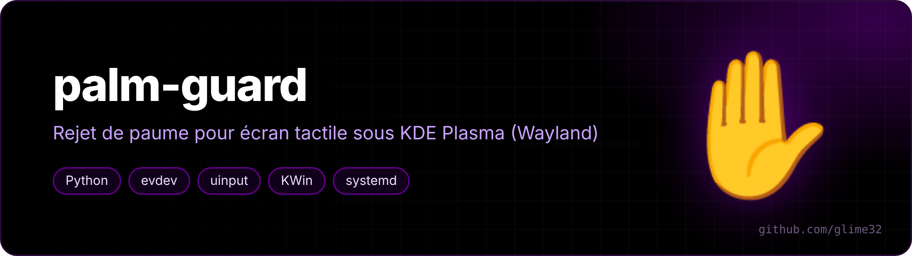

<p align="center"></p>

<p align="center">   </p>

<p align="center"><a href="README.md">🇬🇧 English version</a></p>

Anti-paume pour écran tactile sous KDE Plasma (Wayland), pensé pour dessiner au stylet dans Xournal++.

Sur mon Lenovo Yoga 7 2-in-1, quand je pose la main sur le bord gauche de l'écran pour écrire, la feuille de Xournal++ se met à défiler. libinput ne fait pas de rejet de paume sur les écrans tactiles, et je ne voulais pas couper le tactile complètement (j'aime bien déplacer la page au doigt). Du coup palm-guard se met entre l'écran et KDE et trie les touches.

## Ce qu'il fait

- **Zone morte à gauche (20 mm)** : une touche qui *commence* dans cette bande est ignorée, mais seulement quand une fenêtre Xournal++ est ouverte. Le reste du temps, tous les bords marchent normalement (fermer une fenêtre au doigt, etc.).
- **Stylet proche = tactile coupé** : dès que le stylet survole l'écran, les doigts sont ignorés, puis réactivés 0,3 s après qu'il s'éloigne.
- **Paumes signalées par l'écran** : si le pilote marque une touche comme paume (`MT_TOOL_PALM`), elle est jetée.
- Un doigt au milieu de l'écran passe comme avant : défilement, zoom, tout marche.

Côté batterie c'est neutre : le script dort sur `select()` et ne se réveille que quand on touche l'écran ou qu'on approche le stylet.

## Comment ça marche

```
écran tactile ──grab──▶ palm-guard.py ──uinput──▶ « Palm Guard Touchscreen » ──▶ KDE
                             ▲
                             │ fifo /run/palm-guard.fifo
                    palm-guard-relay.py ◀── D-Bus ── script KWin (fenêtres Xournal++ ?)
```

- `palm-guard.py` (service systemd, root) attrape l'écran avec `evdev`, filtre les slots multitouch et renvoie le reste sur un clone virtuel. Pour annuler un doigt déjà parti, il le passe en `MT_TOOL_PALM` avant de le lever, comme ça libinput annule le geste au lieu de faire un clic.
- Le script KWin (`kwin/palmguard`) regarde si une fenêtre Xournal++ existe et appelle `org.palmguard.SetActive` sur le bus de session.
- `palm-guard-relay.py` (service utilisateur) reçoit cet appel et l'écrit dans la fifo, parce que le service root n'a pas accès au bus de session.

## Installation

Testé sur CachyOS, KDE Plasma 6.8, Lenovo Yoga 7 2-in-1 14ILL10 (Wacom HID 53FD).

```bash
git clone https://github.com/glime32/palm-guard
cd palm-guard
./install.sh
```

Dépendances : `python-evdev`, `python-gobject` (installées par le script sur Arch/CachyOS).

Désinstaller : `./uninstall.sh`

## Réglages

En haut de `palm-guard.py` :

| Variable | Défaut | Rôle |
|---|---|---|
| `BORD_MM` | gauche 20, autres 0 | largeur des zones mortes en mm |
| `XOURNAL_SEUL` | `True` | zone morte seulement si Xournal++ est ouvert |
| `STYLET_BLOQUE` | `True` | couper le tactile quand le stylet est proche |
| `STYLET_DELAI` | `0.3` | délai (s) avant de réactiver après le stylet |
| `PAUME_MM` | `0` | bloquer les touches plus larges que ça (0 = off) |

Après modification : `sudo systemctl restart palm-guard`.

Pour un autre logiciel que Xournal++, changer le test dans `kwin/palmguard/contents/code/main.js`.

## Tester

```bash
sudo systemctl stop palm-guard
sudo python3 /usr/local/bin/palm-guard.py --test
```

Le mode test affiche chaque touche avec sa position et si elle aurait été bloquée, **sans rien filtrer**. Penser à relancer le service après : `sudo systemctl start palm-guard`.

## Limites

- La distance de survol du stylet dépend du matériel, aucun logiciel ne peut l'augmenter.
- Seul le premier écran tactile trouvé est géré.
