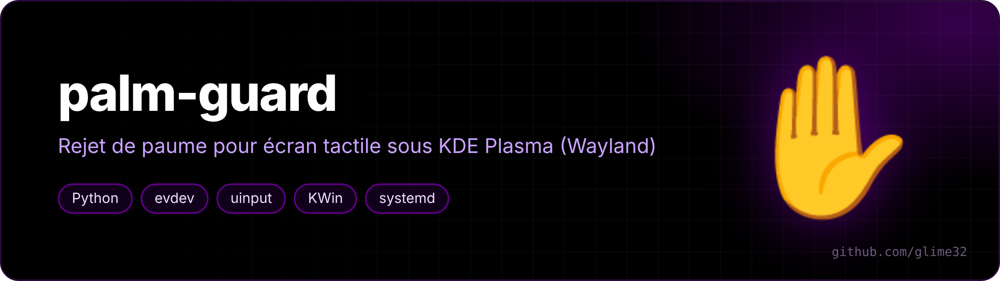
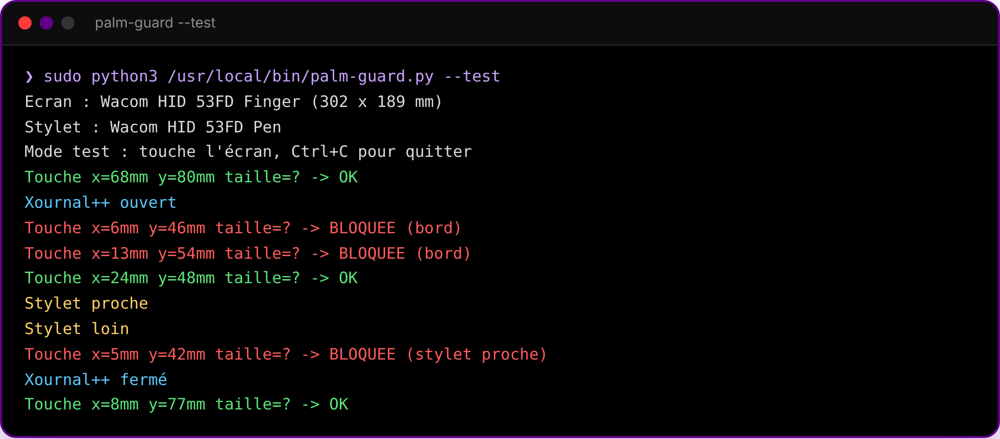
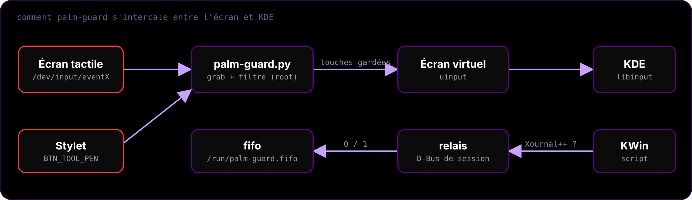

<p align="center"></p>

<p align="center">   </p>

<p align="center"><a href="README.fr.md">🇫🇷 Version française</a></p>

**Palm rejection for touchscreens on KDE Plasma (Wayland)** — made for drawing with a pen in Xournal++.

On my Lenovo Yoga 7 2-in-1, resting my hand on the left edge of the screen while writing would scroll the Xournal++ page. libinput does no palm rejection on touchscreens, and I didn't want to disable touch completely (panning the page with a finger is handy). So palm-guard sits between the touchscreen and KDE and sorts the touches.

## Features

- **Left dead zone (20 mm)** — a touch that *starts* there is ignored, but only while a Xournal++ window is open. Everywhere else every edge works normally.
- **Pen near the screen = touch off** — fingers are ignored while the pen hovers, and come back 0.3 s after it leaves.
- **Palms flagged by the hardware** (`MT_TOOL_PALM`) are dropped.
- A finger in the middle of the screen behaves exactly as before: scroll, zoom, everything.
- **Zero battery cost**: the daemon sleeps on `select()` and only wakes up when you touch the screen or bring the pen close.

<p align="center"><br><sub>Test mode output: touches near the left edge are blocked while Xournal++ is open</sub></p>

## How it works

<p align="center"></p>

- `palm-guard.py` (root systemd service) grabs the touchscreen with `evdev`, filters multitouch slots and re-emits the rest on a virtual clone (`uinput`). To cancel a finger that was already accepted, it switches it to `MT_TOOL_PALM` before lifting it, so libinput cancels the gesture instead of clicking.
- A KWin script checks whether a Xournal++ window exists and calls `org.palmguard.SetActive` on the session bus.
- `palm-guard-relay.py` (user service) receives that call and writes it to a FIFO, because the root service can't reach the session bus.

## Install

```bash
git clone https://github.com/glime32/palm-guard
cd palm-guard
./install.sh        # asks for sudo, installs python-evdev + python-gobject on Arch/CachyOS
```

Uninstall with `./uninstall.sh`. Tested on CachyOS, KDE Plasma 6.8, Lenovo Yoga 7 2-in-1 14ILL10 (Wacom HID 53FD).

## Settings

At the top of `palm-guard.py`:

| Variable | Default | |
|---|---|---|
| `BORD_MM` | left 20, others 0 | width of the dead zones (mm) |
| `XOURNAL_SEUL` | `True` | dead zone only while Xournal++ is open |
| `STYLET_BLOQUE` | `True` | disable touch while the pen hovers |
| `STYLET_DELAI` | `0.3` | delay (s) before touch comes back |
| `PAUME_MM` | `0` | block touches wider than this (0 = off) |

Then `sudo systemctl restart palm-guard`. To protect another app than Xournal++, change the test in `kwin/palmguard/contents/code/main.js`.

## Test mode

```bash
sudo systemctl stop palm-guard
sudo python3 /usr/local/bin/palm-guard.py --test   # prints every touch, filters nothing
sudo systemctl start palm-guard
```
